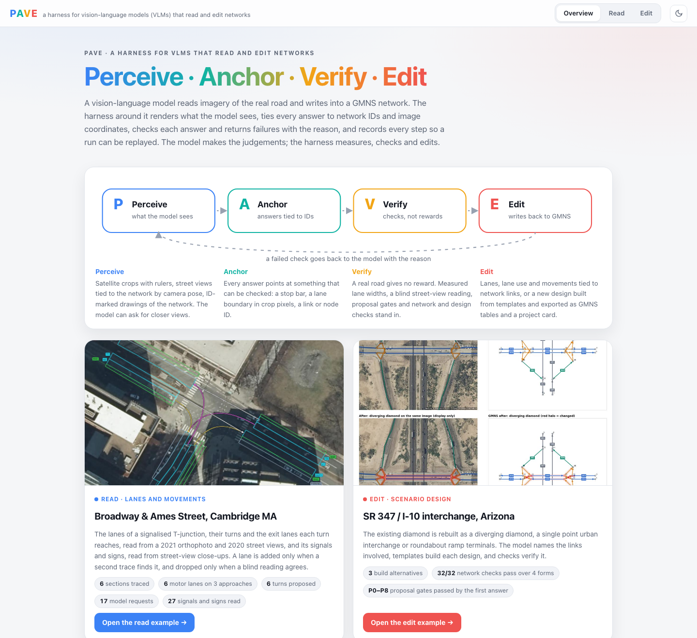
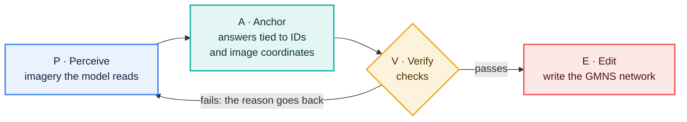
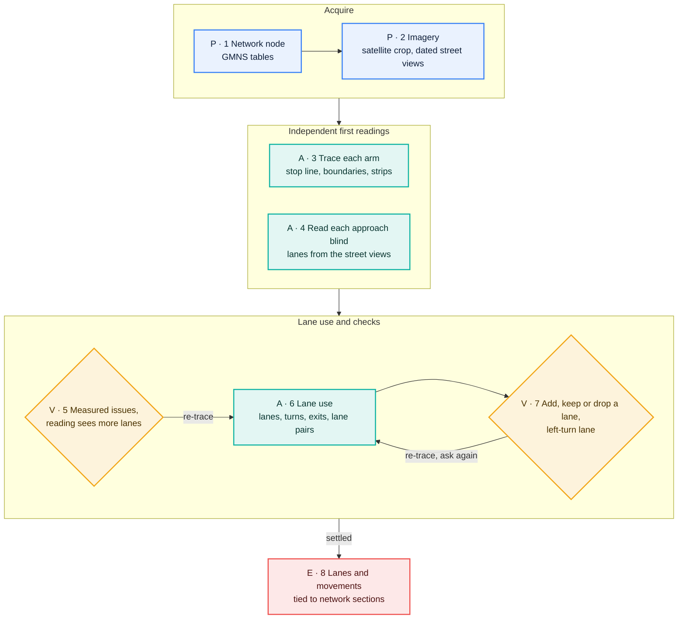
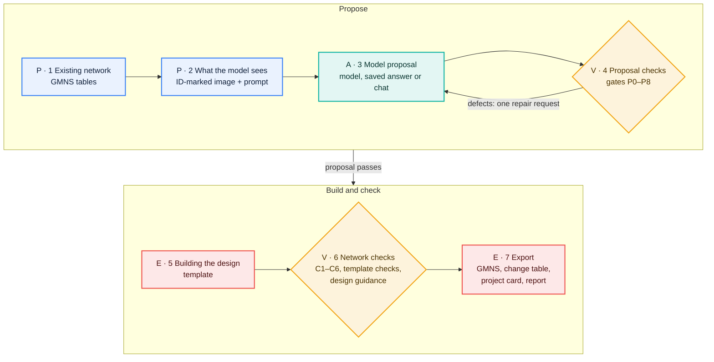

# PAVE

**Perceive · Anchor · Verify · Edit**: a harness for vision-language models (VLMs) that read and edit networks.

A vision-language model reads imagery of the real road and writes into a [GMNS](https://github.com/zephyr-data-specs/GMNS) network. The harness around it does four things:

- **Perceive.** Renders what the model sees.
- **Anchor.** Ties every answer to network IDs and image coordinates.
- **Verify.** Checks each answer and sends a failure back with the reason.
- **Edit.** Writes the result into the network.

Every step is recorded so that a run can be replayed. The model makes the judgements; the harness measures, checks and edits.

The repository holds two applications of the same harness:

- **[Read](read/):** the lanes of an intersection, read from satellite and street-level imagery: the lanes of each approach at the stop bar, the turns each lane allows and the exit lanes each turn reaches.
- **[Edit](edit/):** scenario design on an existing network. Example: rebuilding a diamond interchange as a diverging diamond, a single point urban interchange or roundabout ramp terminals.



[`dashboard/pave.html`](dashboard/pave.html) is the dashboard for both worked examples: one self-contained file. Download it and open it in a browser; only the background map tiles need a connection. The Read worked example's files are in [`read/examples/broadway_ames_2021/`](read/examples/broadway_ames_2021/), with every image and prompt sent and every answer.

[`tutorial/PAVE_tutorial.html`](tutorial/PAVE_tutorial.html) goes through both worked examples step by step: for every model call, the image the model sees, the prompt as sent and the answer it gave. It also covers connecting a model and letting coding agents answer the requests when there is no API. It is one self-contained file of about 10 MB; download it and open it in a browser. `tutorial/build_tutorial.py` rebuilds it from `tutorial/src/` and the Read example.

Model output is a prediction, not reference data.

## The harness



| | Read: inventory | Edit: scenario design |
|---|---|---|
| **Perceive** | Satellite crops of each arm with rulers and stations. Street views tied to the network by camera pose, with the traced lanes projected into them. The model can ask for closer views. | Satellite image and an ID-marked drawing of the network on a grid. |
| **Anchor** | Stop lines and lane boundaries in crop pixels; lanes, turns and lane pairs on network sections. | Existing link and node IDs for each part of the interchange. |
| **Verify** | Measured lane widths and answer checks send a trace back. A blind reading of the street views must agree before a lane is dropped; a second trace must find a lane before it is added. | Proposal gates P0–P8 with one repair request. Network checks C1–C6, template checks, design guidance. |
| **Edit** | Lanes, lane use and movements with their lane pairs, tied to the network's links. | New design built from templates; GMNS tables, change table, Network Wrangler project card. |
| **Example** | [Broadway & Ames Street, Cambridge MA](read/examples/broadway_ames_2021/) | [SR 347 / I-10 interchange, Arizona](edit/scenarios/sr347_i10_ddi/) |

Each step of the two pipelines below carries the stage it belongs to, as on the dashboard: P Perceive, A Anchor, V Verify, E Edit.

### Read pipeline



[`read/README.md`](read/README.md#how-it-works) gives the steps, their code and the output files.

### Edit pipeline



[`edit/README.md`](edit/README.md#pipeline) gives the code and output files of each step.

### Principles

- **Observations stay images.** The model reads rendered imagery, not a text dump of the network. Every source image is kept and can be looked at again.
- **The harness measures, the model judges.** Code computes positions, widths, headings and projections. Open questions go to the model as choices among candidates.
- **Answers point at checkable things.** An answer names stop-bar positions, boundary coordinates, or link and node IDs, each with the image region it relies on.
- **Checks replace an environment.** A real road gives no reward signal. Geometry, cross-view and network checks decide whether an answer stands; a failure returns with the reason for another try.
- **Every step can be replayed.** Prompts, images and raw answers are kept, so a run can be repeated or extended without new model calls.
- **One harness, any model.** The model is a parameter, not part of the design.

## Quick start

```bash
git clone https://github.com/yajunliu99/pave.git
cd pave
```

Both apps reach the vision-language model through one client, [`read/pave_read/vision_client.py`](read/pave_read/vision_client.py) (Edit keeps an identical copy), over any OpenAI-compatible Chat Completions API. One `.env` at the repository root serves both; copy [`.env.example`](.env.example) to `.env`:

| Setting | Used for |
|---|---|
| `OPENAI_API_KEY`, `OPENAI_MODEL`, `OPENAI_BASE_URL` | The model, which must accept images. The base URL defaults to `https://api.openai.com/v1`; a gateway, OpenRouter or a self-hosted server works the same way. |
| `MAPBOX_TOKEN` | Satellite imagery for a new site |
| `GSV_API_KEY` | Read's street views (billed per image) |

The tests and the saved example answers need none of them.

Read (Python 3.12 or newer):

```bash
cd read
pip install -e .
python -m unittest discover -s tests
```

[`read/README.md`](read/README.md) covers the pipeline and its worked example. Without an API, coding agents can answer the requests: see [`read/docs/agent_queue.md`](read/docs/agent_queue.md).

Edit (Python 3.10 or newer):

```bash
cd edit
pip install -e .
python -m pave_edit             # the saved model answer, built as a diverging diamond
python -m unittest discover -s tests
```

[`edit/README.md`](edit/README.md) covers the proposers, the dashboard, design guidance and Network Wrangler project cards.

Rebuild the dashboard after either example changes:

```bash
python dashboard/build_pave.py
```

PAVE has one page template, `dashboard/pave_template.html`: the overview and the Read and Edit views, each with its own data. `dashboard/read_view.py` makes the Read data from the Read example's run and imagery, `edit/tools/build_dashboard.py` makes the Edit data from `edit/`, and `dashboard/build_pave.py` fills all three into `dashboard/pave.html`, making both each time. A page shows only the views it has data for.

## Repository layout

```
read/          Read: lanes and turning movements (Python package pave_read)
  examples/    worked example with imagery, every request and model answer, and results
edit/          Edit: scenario editing (Python package pave_edit)
  scenarios/   worked example with its network, imagery and saved model answers
dashboard/     the PAVE dashboard (both worked examples), its one page template and its build scripts
  vendor/      Leaflet, the map library of the Read view
tutorial/      step-by-step tutorial of both worked examples (one self-contained page) and its build script
docs/          figures
```

## License

MIT. See [LICENSE](LICENSE).

- Imagery in the examples: MassGIS (Commonwealth of Massachusetts) and © Google for Read; © Mapbox, © Maxar for Edit.
- Network data: © OpenStreetMap contributors (ODbL).
- Leaflet, vendored in `dashboard/vendor/`: BSD-2-Clause (`LEAFLET-LICENSE`).
- Third-party components are listed in the READMEs of [read](read/README.md#license) and [edit](edit/README.md).
