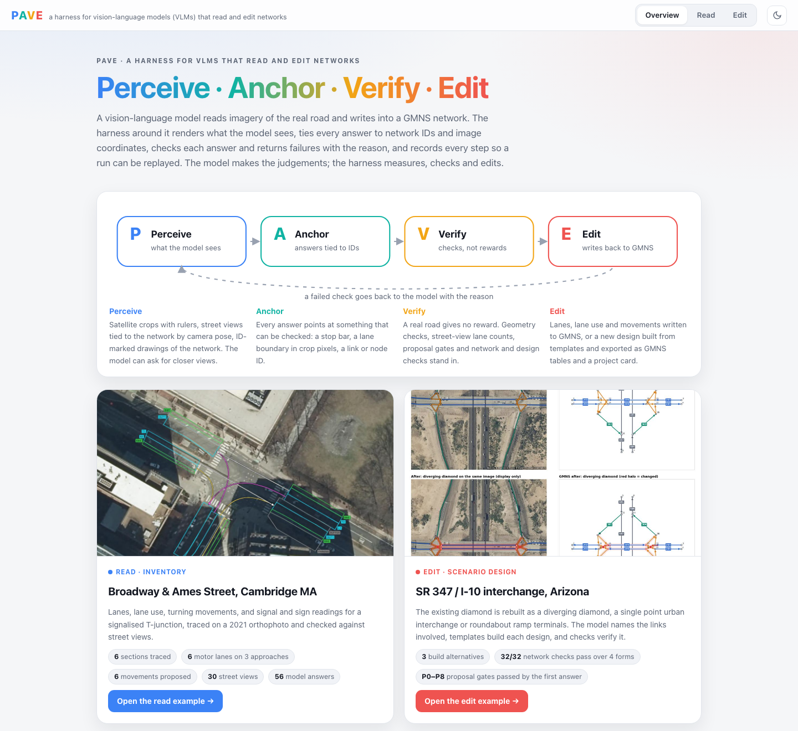
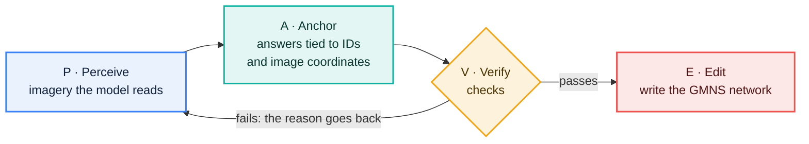
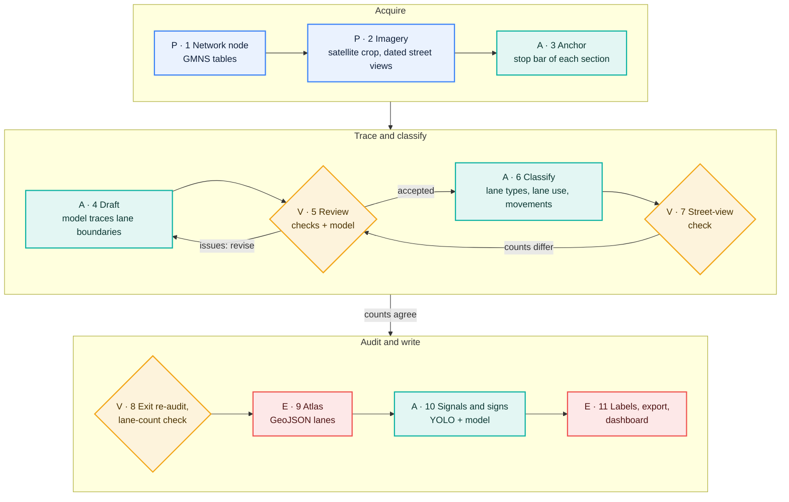
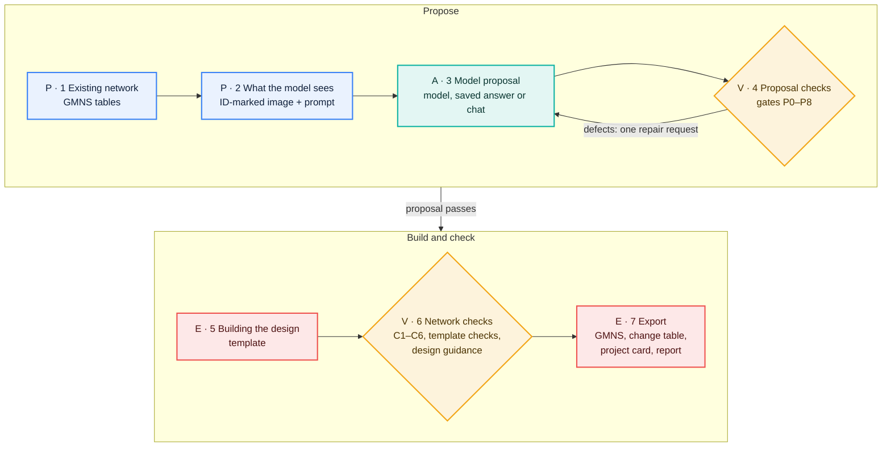

# PAVE

**Perceive · Anchor · Verify · Edit**: a harness for vision-language models (VLMs) that read and edit networks.

A vision-language model reads imagery of the real road and writes into a [GMNS](https://github.com/zephyr-data-specs/GMNS) network. The harness around it does four things:

- **Perceive.** Renders what the model sees.
- **Anchor.** Ties every answer to network IDs and image coordinates.
- **Verify.** Checks each answer and sends a failure back with the reason.
- **Edit.** Writes the result into the network.

Every step is recorded so that a run can be replayed. The model makes the judgements; the harness measures, checks and edits.

The repository holds two applications of the same harness:

- **[Read](read/):** the inventory of an intersection, read from satellite and street-level imagery. It covers lanes, lane use, turning movements, and signals and signs.
- **[Edit](edit/):** scenario design on an existing network. Example: rebuilding a diamond interchange as a diverging diamond, a single point urban interchange or roundabout ramp terminals.



[`dashboard/pave.html`](dashboard/pave.html) is the dashboard for both worked examples: one self-contained file. Download it and open it in a browser; only the background map tiles need a connection.

Model output is a prediction, not reference data.

## The harness



| | Read: inventory | Edit: scenario design |
|---|---|---|
| **Perceive** | Satellite crops with rulers. Street views tied to the network by camera pose. The model can ask for closer views. | Satellite image and an ID-marked drawing of the network on a grid. |
| **Anchor** | Stop bars, lane boundaries in crop pixels, regions and movements on network sections. | Existing link and node IDs for each part of the interchange. |
| **Verify** | Geometry checks, a review loop, street-view lane counts held against the traced lanes, exit re-audit. | Proposal gates P0–P8 with one repair request. Network checks C1–C6, template checks, design guidance. |
| **Edit** | Lanes, lane use, movements and signal readings written as GMNS-ready tables and GeoJSON. | New design built from templates; GMNS tables, change table, Network Wrangler project card. |
| **Example** | [Broadway & Ames Street, Cambridge MA](read/examples/broadway_ames_2021/) | [SR 347 / I-10 interchange, Arizona](edit/scenarios/sr347_i10_ddi/) |

Each step of the two pipelines below carries the stage it belongs to, as on the dashboard: P Perceive, A Anchor, V Verify, E Edit.

### Read pipeline



[`read/README.md`](read/README.md#pipeline) gives the code and output files of each step.

### Edit pipeline



[`edit/README.md`](edit/README.md#pipeline) gives the code and output files of each step.

### Principles

- **Observations stay images.** The model reads rendered imagery, not a text dump of the network. Every source image is kept and can be looked at again.
- **The harness measures, the model judges.** Code computes positions, widths, headings and projections. Open questions go to the model as choices among candidates.
- **Answers point at checkable things.** An answer names stop-bar positions, boundary coordinates, or link and node IDs, each with the image region it relies on.
- **Checks replace an environment.** A real road gives no reward signal. Geometry, cross-view and network checks decide whether an answer stands; a failure returns with the reason for another try.
- **Every step can be replayed.** Prompts, images and raw answers are kept, so a run can be repeated or extended without new model calls.
- **One harness, any model.** The model is a parameter, not part of the design.

## Quick start

```bash
git clone https://github.com/yajunliu99/pave.git
cd pave
```

Read (Python 3.12 or newer):

```bash
cd read
pip install -r requirements.txt
python -m unittest discover -s tests
```

[`read/README.md`](read/README.md) covers the API keys, the full pipeline and its worked example.

Edit (Python 3.10 or newer):

```bash
cd edit
pip install -e .
python -m vlm4scenario          # the saved AI answer, built as a diverging diamond
python -m unittest discover -s tests
```

[`edit/README.md`](edit/README.md) covers the proposers, the dashboard, design guidance and Network Wrangler project cards.

Rebuild the combined dashboard after either example changes:

```bash
python dashboard/build_pave.py
```

## Repository layout

```
read/          Read: lane and movement inventory (Python package movement_fixer)
  examples/    worked example with imagery, results and model answers
  dashboard/   Intersection Explorer template and the example dashboard
edit/          Edit: scenario editing (Python package vlm4scenario)
  scenarios/   worked example with its network, imagery and saved AI answers
  dashboard/   scenario editor template and the example dashboard
dashboard/     the combined PAVE dashboard and its build script
docs/          figures
```

## License

MIT. See [LICENSE](LICENSE).

- Imagery in the examples: MassGIS (Commonwealth of Massachusetts) and © Google for Read; © Mapbox, © Maxar for Edit.
- Network data: © OpenStreetMap contributors (ODbL).
- Third-party components are listed in the READMEs of [read](read/README.md#license) and [edit](edit/README.md).
