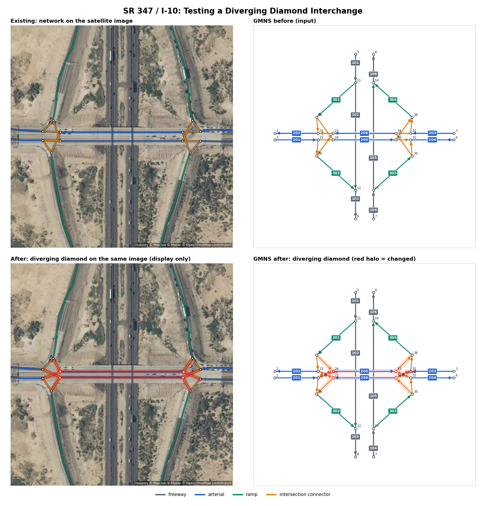
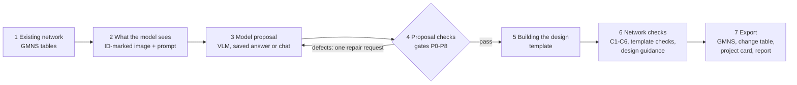

# PAVE · Edit: scenario editing of road networks

Part of [PAVE](../README.md), a harness for vision-language models (VLMs) that read and edit networks. Run every command below from this `edit/` folder; the Python package is `pave_edit`.

Model-assisted scenario editing of GMNS road networks. A vision-language model (VLM) reads the site imagery and an ID-marked drawing of the network and names the existing links that make up the facility to change. Code templates build the new design, and checks verify the result before export.

Worked example: the SR 347 / I-10 interchange at Queen Creek Rd, Arizona. The existing conventional diamond is rebuilt as a diverging diamond (DDI), a single point urban interchange (SPUI) or a diamond with roundabout ramp terminals.



## Quick start

```bash
git clone https://github.com/yajunliu99/pave.git
cd pave/edit
pip install -e .

python -m pave_edit                    # saved model answer -> diverging diamond
python -m unittest discover -s tests
```

The interactive walkthrough is the Edit view of the PAVE dashboard, [`../dashboard/pave.html`](../dashboard/pave.html) (one self-contained file).

## Pipeline



| Step | What it does | Code | Output files |
|---|---|---|---|
| 1 Existing network | Reads the base GMNS tables, rebuilds the turning movements and reads the interchange type from the tables | `gmns.py`, `proposal.py` | |
| 2 What the model sees | Renders one image (satellite panel and ID-marked network with a 6 × 6 grid) and writes the prompt with the link and node tables | `render.py`, `proposal.py` | `ai_input.png`, `ai_prompt.txt` |
| 3 Model proposal | Gets one JSON answer: evidence, facility class, terminal bindings, operations, expected facts, what could not be established | `vlm.py` | `proposal.json` |
| 4 Proposal checks | Gates P0–P8 check the answer format, IDs, start/end nodes and ramp-terminal structure; a failed answer gets one repair request with the defects | `proposal.py` | `proposal_checks.json`, `repair_prompt.txt` |
| 5 Building the design | The template for the requested form (DDI, SPUI, roundabout terminals) builds the new network; `--target` sets the form | `templates.py` | |
| 6 Network checks | Checks C1–C6 (table integrity, all trips possible, required and prohibited turns, grade separation, freeway unchanged, no change outside the interchange), the template's own checks (DDI-1..3, SPUI-1..2, RBT-1..3) and the design guidance | `checks.py`, `standards.py` | `network_checks.json`, `design_guidance.json` |
| 7 Export | Writes the GMNS after-network with route checks, the change table, an edit summary, Network Wrangler tables and project card, and a before/after figure | `pipeline.py`, `diff.py`, `wrangler.py`, `render.py` | `after_network/`, `change_table.csv`, `edit_summary.json`, `wrangler/`, `before_after.png` |

Each run writes to `out/<scenario>/<label>/`, including `report.md` and `run_state.json`.

Results for SR 347 / I-10:

| Form | Nodes / links / movements | Network checks | Design guidance |
|---|---|---|---|
| Existing diamond | 24 / 28 / 32 | 6/6 | context |
| Diverging diamond | 28 / 32 / 36 | 9/9 | 4 met, 1 measured on the drawing, 5 need design data |
| Single point (SPUI) | 20 / 24 / 28 | 8/8 | 2 met, 1 measured on real roads, 5 need design data, 3 background |
| Roundabout terminals | 36 / 40 / 44 | 9/9 | 3 met, 3 need design data |

## Repository layout

```
pave_edit/             package: cli, pipeline, one module per step
scenarios/sr347_i10_ddi/
  base/                existing network (GMNS node, link, movement, config)
  scenario.json        request sentence, site, imagery, approach-road names
  proposals/           saved model answer with its input image and prompt
  satellite_mapbox_*   site imagery; georef.json registers the network on it
tools/                 build_dashboard.py, wrangler_roundtrip.py, wrangler_scenarios.py
tests/
```

## Proposers

```bash
python -m pave_edit                            # replays scenarios/<scenario>/mock_proposal.json
python -m pave_edit --target spui              # same answer, built as a SPUI
python -m pave_edit --target roundabout_diamond
python -m pave_edit --proposal scenarios/sr347_i10_ddi/mock_proposal_bad.json      # wrong binding, rejected at step 4
python -m pave_edit --backend openai --model <vision model>                       # OpenAI-compatible API
```

`--backend openai` calls an OpenAI-compatible `/chat/completions` endpoint with one image and the prompt per request, in JSON mode. It uses PAVE's one model client, [`pave_edit/vision_client.py`](pave_edit/vision_client.py), an exact copy of Read's (a test keeps the two equal). Settings: `OPENAI_API_KEY`, `OPENAI_MODEL`, `OPENAI_BASE_URL`, from the environment or the `.env` at the PAVE root (see [`../.env.example`](../.env.example)) or in this folder; `--env-file` names another file, and `--model` and `--base-url` override the file. Answers are cached in `cache/openai/`.

A chat model can also be the proposer:

```bash
python -m pave_edit --prepare-only --hide-names      # writes ai_input.png and ai_prompt.txt
python -m pave_edit --backend session --proposal <answer.json> --hide-names
```

`--hide-names` blanks road names in the tables. `scenarios/sr347_i10_ddi/proposals/blind_mapbox_nonames.json` is a blind answer from a vision-language model that saw only the matching `.input.png` and `.prompt.txt`; it passed every check on the first answer and is the answer shown on the dashboard.

## Dashboard

```bash
python tools/build_dashboard.py \
  --proposal scenarios/sr347_i10_ddi/proposals/blind_mapbox_nonames.json \
  --proposer-input scenarios/sr347_i10_ddi/proposals/blind_mapbox_nonames.input.png \
  --proposer-prompt scenarios/sr347_i10_ddi/proposals/blind_mapbox_nonames.prompt.txt
```

Runs the pipeline for the existing condition and the two build alternatives (DDI, SPUI) and writes `out/dashboard/sr347_scenario_editor.html` (`--out` to change): PAVE's page (`../dashboard/pave_template.html`) with the Edit view alone. `python ../dashboard/build_pave.py` runs it with `--data-out` and puts the view's data into the PAVE dashboard. The view walks through the seven steps, shows Before and After on the schematic drawing or the satellite image, highlights changes, follows trips between approach roads, and lists the design guidance with its sources.

## Design guidance

`pave_edit/standards.py` rates each form against design guides: **met**, **not_met**, **schematic** (measured on the drawing), **measured** (measured on real roads), **needs_data** (needs lane-level design, signal timing or volumes) or **info**. Each item cites the section and page of its source:
- **Arizona**: ADOT Roadway Design Guidelines, 2021 edition with January 2025 revisions: §502.2, §505.1 B, §505.2, §505.3.
- **National**: NCHRP Research Report 959 (§1.5, §6.4.7.1, §6.4.7.3), NCHRP Report 345, NCHRP Research Report 1043, AASHTO Green Book 2018 ch. 10, FHWA Traffic Analysis Toolbox Vol. XIV ch. 7.1.
- **Other state**: Caltrans Design Information Bulletin 92 (SPUI skew angle).

## Network Wrangler project cards

Step 7 writes the base network as [Network Wrangler](https://github.com/network-wrangler) roadway tables (`wrangler/base/`) and the edit as a project card (`wrangler/project_card.yml`).

```bash
uv run --no-project --python 3.13 --with "network-wrangler==1.0b4" --with matplotlib \
  python tools/wrangler_roundtrip.py out/sr347_i10_ddi/mock      # apply the card and compare
uv run --no-project --python 3.13 --with "network-wrangler==1.0b4" --with matplotlib \
  python tools/wrangler_scenarios.py                            # combine cards on one network
uv run --no-project --python 3.13 --with "network-wrangler==1.0b4" --with matplotlib --with pillow \
  python -m unittest discover -s tests
```

Applying each card reproduces the pipeline's network (DDI: 7 changes, SPUI: 11, roundabout: 6). `wrangler_scenarios.py` combines the cards with two example widening cards for the Queen Creek Rd bridge:

| Combination | Result |
|---|---|
| Widening card (requires the DDI) submitted before the DDI card | DDI applied first, then the widening |
| Widening card alone | refused: missing prerequisite |
| DDI and SPUI cards (SPUI declares a conflict) | refused: declared conflict |
| DDI and a widening card that expects 2 lanes | stopped after the DDI |

## Satellite imagery

`pave_edit/imagery.py` fetches imagery from the Mapbox Static Images API (`MAPBOX_TOKEN`), centred on 33.255569, -111.948255. `satellite_mapbox_aligned.jpg` is rotated to bearing 326.8° to match the network axes and is the image the model sees. `georef.json` holds the base nodes and links measured on `satellite_mapbox_wide.jpg`; `pave_edit/georef.py` uses it to draw any network on the imagery.

## Extending

- **New scenario**: copy `scenarios/sr347_i10_ddi/` and replace `base/`, the images and `scenario.json`.
- **New template**: add `fn(net, terminals, scenario) -> (after, log, spec)` to `pave_edit/templates.py`, register it in `TEMPLATES` and `proposal.IMPLEMENTED_CONVERSIONS`, and add its guidance items to `standards.py`.

## License and credits

Code: MIT (see `LICENSE`).

- Satellite imagery © Mapbox © Maxar © OpenStreetMap contributors.
- The SR 347 / I-10 base network is built from OpenStreetMap data © OpenStreetMap contributors.
- Design guidance: ADOT, NCHRP, AASHTO, FHWA and Caltrans documents, cited by section and page.
