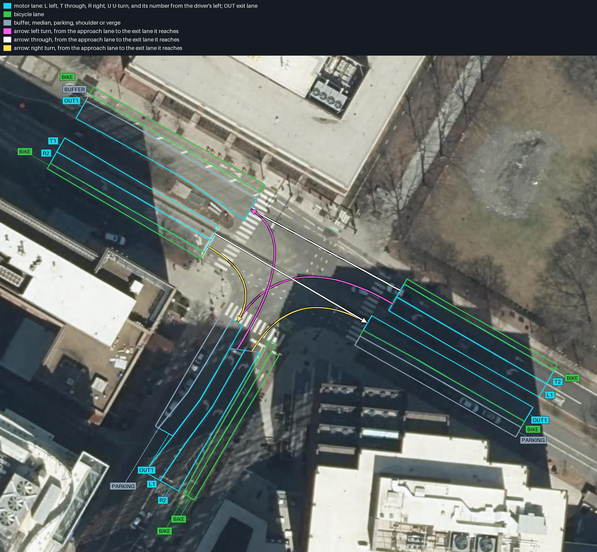
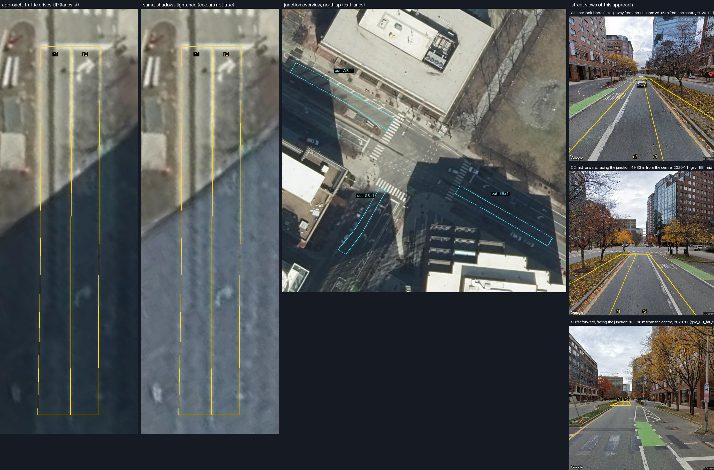
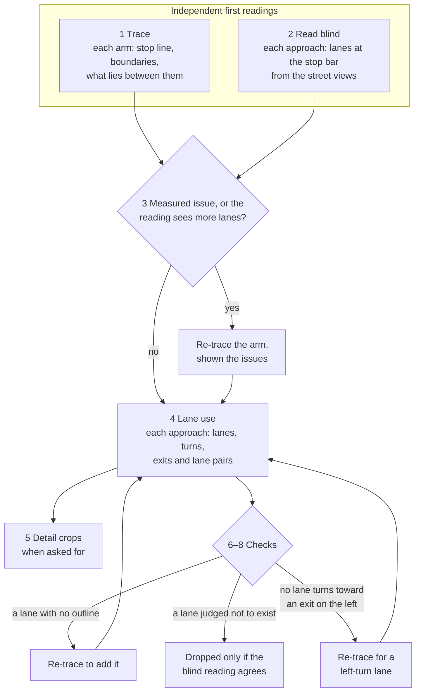

# PAVE · Read: lanes and turning movements at a junction

Part of [PAVE](../README.md), a harness for vision-language models (VLMs) that read and edit networks. Run every command below from this `read/` folder; the Python package is `pave_read`.

Start from a node of a [GMNS](https://github.com/zephyr-data-specs/GMNS) network (`node.csv`, `link.csv`). For every approach of the junction, PAVE Read finds the lanes at the stop bar, the turns each lane allows and the exit lanes each turn reaches. A VLM reads them from a satellite crop and street-level views.

The work is divided:

- **Code measures.** It cuts a window along each arm of the junction from the link geometry, draws rulers and stations on it, places the street-view cameras, projects traced lanes into the street views, and measures every traced lane's width.
- **Rules check.** Each answer is validated, and measured issues (a lane too wide or too narrow for one lane, a bicycle strip as wide as a lane between two lanes) send a trace back.
- **The model judges** only what measurement cannot settle: where the painted lines are, what lies between them, and which turns each lane allows.

Each answer is anchored to the network: a traced lane is an outline on the crop of one link, and a turn names its exit section and its lane pairs. A lane is added only when a second trace finds it, and removed only when an independent reading of the street views agrees.

Model output is a prediction, not reference data.

## Example

These figures come from the worked example in [`examples/broadway_ames_2021/`](examples/broadway_ames_2021/): Broadway & Ames Street in Cambridge, MA, a signalised T-junction, read from a 2021 orthophoto and street views from 2020. The example folder holds every image and prompt sent and every answer.



Each traced strip is outlined and tagged: approach lanes with their turns and number from the driver's left (L left, T through, R right; T1 is a through lane, the leftmost), exit lanes as OUT, bicycle lanes, buffers and parking by name. Each arrow runs from an approach lane to the exit lane its turn reaches: magenta left, white through, yellow right.

| Approach | Lanes from the driver's left | Turns and the exit lanes they reach |
|---|---|---|
| EB (Broadway from the west) | through, right only | through → exit EB; right → exit SB |
| WB (Broadway from the east) | left only, through | left → exit SB; through → exit WB |
| NB (Ames Street) | left only, right only | left → exit WB; right → exit EB |

The run took 9 model requests: a trace of each arm, a blind reading of each approach and the lane use of each approach. The blind readings counted the same lanes as the traces, and no lane-use answer asked for more, so no other step ran.

Before lane use, the traced lanes are projected into the street views. This is the eastbound approach's lane-use sheet:



## How it works

One command reads one junction: [`scripts/pipeline/run_read.py`](scripts/pipeline/run_read.py). A four-arm junction takes about 12–20 model requests.



| Step | Request | What it does |
|---|---|---|
| 1 Trace | one per arm | The model traces the stop line, the exit start and every lane boundary of both carriageways on a crop with rulers and stations, and says what lies between each pair of boundaries: motor lane, bicycle lane, parking, median and so on. The street-view cameras are marked on the crop. |
| 2 Read | one per approach | Independently of the trace, the model reads the lane layout at the stop bar from the satellite crop and the approach's street views (a look-back near the stop bar, mid and far forward). |
| 3 Re-trace | where needed | Where the reading is settled and sees more lanes than the trace, or a traced lane measures wider or narrower than one lane, the trace is shown back with the issues, its boundaries projected into the street views, and the model corrects or keeps it. |
| 4 Lane use | one per approach | The traced lanes are projected into the street views. The model says whether each lane exists, which turns it allows, and for each turn the exit and its lane pairs. Lanes and turns are the permanent layout; temporary traffic control is reported apart. |
| 5 Detail | where asked | The model may ask for up to three native-resolution crops of the views, and answers again with them. |
| 6 Add a lane | where needed | A lane that the lane-use answer sees with no outline of its own sends the arm back to tracing; the new lanes are kept only if there are more of them. |
| 7 Keep a lane | where needed | A lane judged not to exist is dropped only when the blind reading (2) agrees. Otherwise lane use is asked again and must keep it. |
| 8 Left-turn lane | where needed | Where an exit lies to the left but no lane allows a left turn, the arm is re-traced to look for a left-turn lane, and lane use is asked again. |

The steps are described in full at the top of [`run_read.py`](scripts/pipeline/run_read.py). The prompts are built in [`pave_read/harness/stages.py`](pave_read/harness/stages.py) (trace, lane use) and [`pave_read/harness/views.py`](pave_read/harness/views.py) (blind reading); the measurements are in [`pave_read/harness/geometry.py`](pave_read/harness/geometry.py).

The pipeline has no site-specific code, and no lane count from the network or reference data enters a prompt. Everything particular to a junction comes from its network and imagery.

## Requirements

- Python 3.12 or newer. Development and testing used 3.14.
- Python packages: `pip install -e .` installs `pave_read` and its dependencies (Pillow, NumPy, Requests, OpenCV).
- Settings in a `.env` file at the PAVE root (shared with Edit) or in this folder. Copy [`../.env.example`](../.env.example) to `../.env`. Variables already set in the environment take precedence.
  - `OPENAI_API_KEY`, `OPENAI_MODEL` and, for a server other than OpenAI's, `OPENAI_BASE_URL` for the VLM. [`pave_read/vision_client.py`](pave_read/vision_client.py) speaks the OpenAI Chat Completions protocol, so any compatible server works. The model must accept images. Each answer records the model and its provider, and a cached answer is replayed only for the same model.
  - `MAPBOX_TOKEN` for satellite imagery.
  - `GSV_API_KEY` for the Street View Static API. Image requests are billed; metadata requests are free.

Without an API, coding agents can answer the requests through a file queue: see [`docs/agent_queue.md`](docs/agent_queue.md).

## Usage

Fetch the satellite crop and street views for a node and write its imagery folder. `--plan-only` lists the requests without contacting any service:

```bash
python scripts/pipeline/acquire_site_imagery.py --node-id 7828 \
  --node-csv path/to/node.csv --link-csv path/to/link.csv --output runs/imagery_site_7828
```

`--policy policy.json` overrides the imagery settings, for example a dated orthophoto, street views captured before a date, or pinned panoramas. See [`configs/acquisition/`](configs/acquisition/).

Read the junction:

```bash
python scripts/pipeline/run_read.py --imagery runs/imagery_site_7828 --output runs/read_site_7828
```

| Flag | Effect |
|---|---|
| `--prepare-only` | Builds the first trace and reading sheets and their prompts, and makes no request. |
| `--stop-after retrace` | Runs steps 1–3 only and writes `trace_check.json`. |
| `--cache-only` | Forbids any new model request: replays cached answers. |
| `--reuse-cache-from <run>` | Reuses the answers of an earlier run to identical requests (same image, prompt and model). |
| `--max-calls N` | Stops after N model requests (default 40). |
| `--lane-width-m LOW HIGH` | A traced motor lane outside this width range is re-checked (default 2.5–5.0 m). |

Every answer is cached in the run folder, so a run that stops can be started again and resumes.

## Outputs

| File | Contents |
|---|---|
| `lanes.json` | Every section (approach at the stop bar, exit) with its traced regions: surface type, width, outline on the satellite crop, and for approach lanes the allowed turns with their basis and confidence. |
| `movements.json` | Each turn of each approach: its exit and lane pairs (approach lane to exit lane, numbered from the driver's left). |
| `traces.json`, `readings.json`, `uses.json` | Every trace (with first traces and re-traces), blind reading and lane-use answer, with the checks applied. |
| `summary.json` | The requests made by step, the checks, and the lane count of each section. |
| `result.jpg` | Every traced region on the satellite image, labelled, with an arrow for each proposed turn from its approach lane to the exit lane it reaches. |
| `sheets/` | Every image sent to the model, and the first prompts. |
| `vlm/<step>/` | For each request: the prompt, the raw answer, the parsed and validated answer, and `latest.json`. |

## Tests

```bash
python -m unittest discover -s tests
```

## Repository layout

```
pave_read/            library
  harness/            windows and measurements, prompts and validators, street-view sheets
  autoloop/           crops, rulers, frames and street-view projection
  fusion/             imagery acquisition, blind-reading validation
  hybrid/             model requests and their cache, geometry helpers
  vlm_bridge.py       file queue for agents answering in place of an API
scripts/pipeline/     acquire_site_imagery.py, run_read.py, vlm_bridge.py
configs/              imagery policies, run and result folders
examples/             worked example: Broadway & Ames Street, Cambridge MA
docs/                 answering requests with agents
tests/                unit tests
```

An earlier, longer pipeline (draft-and-review tracing, a lane atlas in GeoJSON, a signal and sign audit with YOLO, and an interactive explorer) is kept in the git tag `full-pipeline`.

## What is included

Code, tests, the imagery policy of the example, and one worked example with its imagery, network excerpt and results. Imagery is © its providers and subject to their terms: Google for street views; MassGIS for the example's satellite image; Mapbox and its imagery providers for the default satellite source.

## License

MIT. See [LICENSE](../LICENSE).
