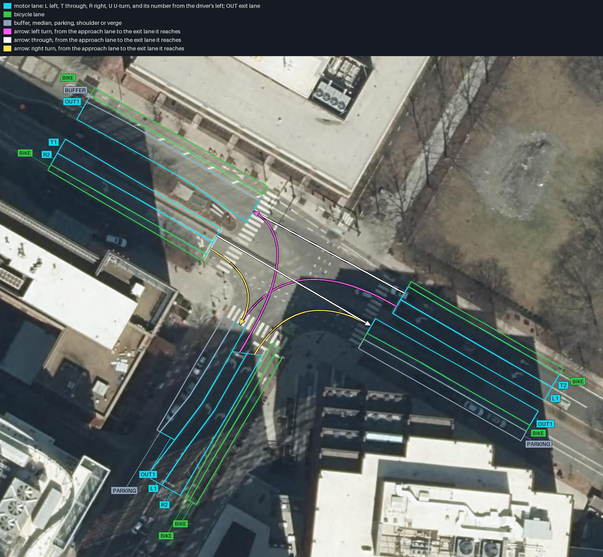
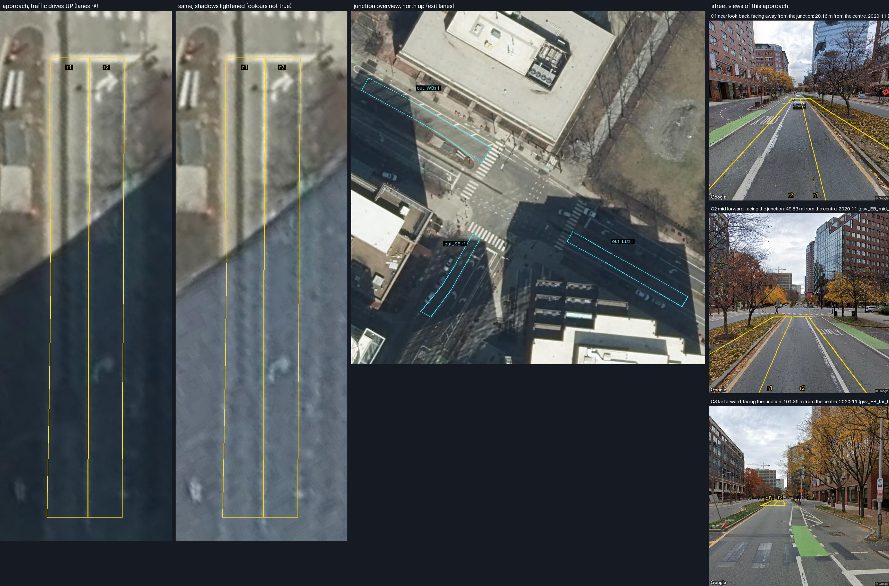

# Example: Broadway & Ames Street, Cambridge, Massachusetts

This is one complete run of PAVE Read at a signalised T-junction in Kendall Square. Broadway runs east–west, with a median near the junction and bicycle lanes in both directions. Ames Street joins from the south.

The junction has been rebuilt since about 2022–2023, so the run reads it from imagery taken before that work:

- **Satellite:** MassGIS 2021 orthoimagery, spring 2021, leaf-off, 15 cm.
- **Street views:** Google's own panoramas from November 2020, at four positions on each approach. The run uses three of them: a look-back near the stop bar, and forward views at about 50 m and 100 m.
- **Network:** OpenStreetMap as of 1 May 2021, converted to GMNS. In that network the junction is node 95.

The Street View metadata service returns only the latest panorama at a location. Here the November 2020 panoramas are hidden behind captures from 2024 and 2026, so they were looked up in Google Maps' time travel and named in `pinned_panoramas` of [`configs/acquisition/cambridge_pre_construction.json`](../../configs/acquisition/cambridge_pre_construction.json). The acquisition checks each named panorama's date, position and carriageway like any other.

There is no reference lane data for this junction. Model output is a prediction, not reference data.



Each traced strip is outlined and tagged: approach lanes with their turns and number from the driver's left (L left, T through, R right; T1 is a through lane, the leftmost), exit lanes as OUT, bicycle lanes, buffers and parking by name. Each arrow runs from an approach lane to the exit lane its turn reaches: magenta left, white through, yellow right.

## What the model read

| Approach | Lanes from the driver's left | Turns and the exit lanes they reach |
|---|---|---|
| EB (Broadway from the west) | through, right only | through: lane 1 → exit EB lane 1; right: lane 2 → exit SB lane 1 |
| WB (Broadway from the east) | left only, through | left: lane 1 → exit SB lane 1; through: lane 2 → exit WB lane 1 |
| NB (Ames Street) | left only, right only | left: lane 1 → exit WB lane 1; right: lane 2 → exit EB lane 1 |

Each approach also has a bicycle lane on its curb side, and each exit has one motor lane. No U-turn and no temporary traffic control were reported.

The run took 9 model requests:

- **Trace (3):** one per arm. The model traced the stop line and every lane boundary of both carriageways on the arm's crop, and said what lies between each pair of boundaries.
- **Blind reading (3):** one per approach, from the satellite crop and the street views, without the trace. Each counted two motor lanes, the same as the trace, so no arm was traced again.
- **Lane use (3):** one per approach, with the traced lanes projected into the street views. No answer asked for closer views, saw a lane without an outline, or judged a traced lane not to exist, so no further step ran.



The lane-use sheet of the eastbound approach: the approach crop with the traced lanes r1 and r2, the same crop with shadows lightened, the junction with the exit lanes, and the three street views with the lanes projected into them.

## Signals and signs

The optional signal and sign step ([`scripts/pipeline/run_signals.py`](../../scripts/pipeline/run_signals.py)) then read the same junction from Street View, with the policy in [`configs/signals/cambridge_pre_construction.json`](../../configs/signals/cambridge_pre_construction.json): two panoramas per approach from October 2019 to November 2020, looking toward the junction, and close-ups that the model asked for. It took 8 model requests: an inventory and a reading per approach, and two readings sent back once because a sign scoped to the whole approach was also tied to a lane.

| Approach | What the model read |
|---|---|
| EB | two heads with green through arrows; a head with a red right arrow, tied to lane 2; NO TURN ON RED; a probable No U-Turn sign |
| WB | a head with a red left arrow, tied to lane 1, beside the plaque LEFT TURN SIGNAL; two heads with green through arrows, tied to lane 2; a keep-right sign; a pedestrian signal |
| NB | two heads with green left arrows, tied to lane 1; a head with a red right arrow, tied to lane 2; NO TURN ON RED |

In all there are 27 readings, each with the image boxes that show it: 11 readable, 9 partly readable and 7 unreadable, each marked as such, and 7 tied to lanes. Lamp colours are as captured, not phases. Every approach asked for a second round of views, but no other usable panorama from the window was found near the cameras. Six close-ups could not be taken: the Street View Static API returned 404 for two of the older panoramas (EB 2020-10, NB 2019-10), and the readings were made without them.

## Files

```
imagery/          site.json and base_config.json (as acquire_site_imagery.py writes them), the satellite image
                  and the street views
network/          the GMNS network excerpt (node.csv, link.csv)
run/              the run
  lanes.json        every section with its traced regions and, for approach lanes, the allowed turns
  movements.json    each turn of each approach with its exit and lane pairs
  traces.json, readings.json, uses.json
                    every trace, blind reading and lane-use answer, with the checks applied
  summary.json      the requests by step, the checks and the lane counts
  result.jpg        the figure above
  sheets/           every image sent to the model, and the trace prompts
  vlm/<step>/       for each request: the prompt, the raw answer, the parsed and validated answer
  signals/          the signal and sign step: signals.json (the readings), summary.json, views.json, the lane
                    scenes and sheets sent to the model, vlm/, yolo/ and cache/ (every Street View response used)
```

The answers were given by `claude-opus-5-5` through the agent queue ([`docs/agent_queue.md`](../../docs/agent_queue.md)), one fresh agent per request. Each raw answer records the model, the agent and when it answered.

## Replay

The run replays from its own answers with no model request. From the `read/` folder:

```bash
PAVE_VLM_BACKEND=bridge PAVE_BRIDGE_MODEL=claude-opus-5-5 PAVE_BRIDGE_PROVIDER=claude_code_subagent \
python scripts/pipeline/run_read.py --imagery examples/broadway_ames_2021/imagery --output runs/example_replay \
  --reuse-cache-from examples/broadway_ames_2021/run --cache-only
```

The replay writes the same `lanes.json` and `movements.json`. The signal and sign step replays the same way, from its own Street View cache, and writes the same `signals.json` (it needs `pip install -e ".[signals]"` and the YOLO checkpoint, see [`../../README.md`](../../README.md#signals-and-signs-optional)):

```bash
PAVE_VLM_BACKEND=bridge PAVE_BRIDGE_MODEL=claude-opus-5-5 PAVE_BRIDGE_PROVIDER=claude_code_subagent \
python scripts/pipeline/run_signals.py --imagery examples/broadway_ames_2021/imagery --read examples/broadway_ames_2021/run \
  --policy configs/signals/cambridge_pre_construction.json --output runs/example_signals_replay \
  --seed-cache examples/broadway_ames_2021/run/signals/cache --reuse-cache-from examples/broadway_ames_2021/run/signals --cache-only
```

To read the junction with your own model, drop the first line and `--reuse-cache-from … --cache-only`, and set the model in `.env` (see [`../../README.md`](../../README.md#requirements)).

Imagery: MassGIS (Bureau of Geographic Information), Commonwealth of Massachusetts; street views © Google. Network data © OpenStreetMap contributors (ODbL).
