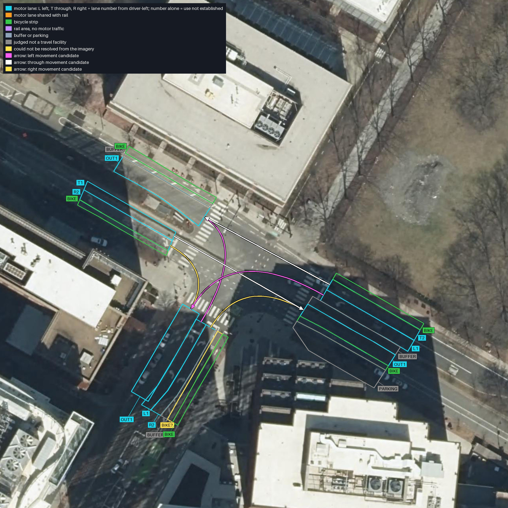
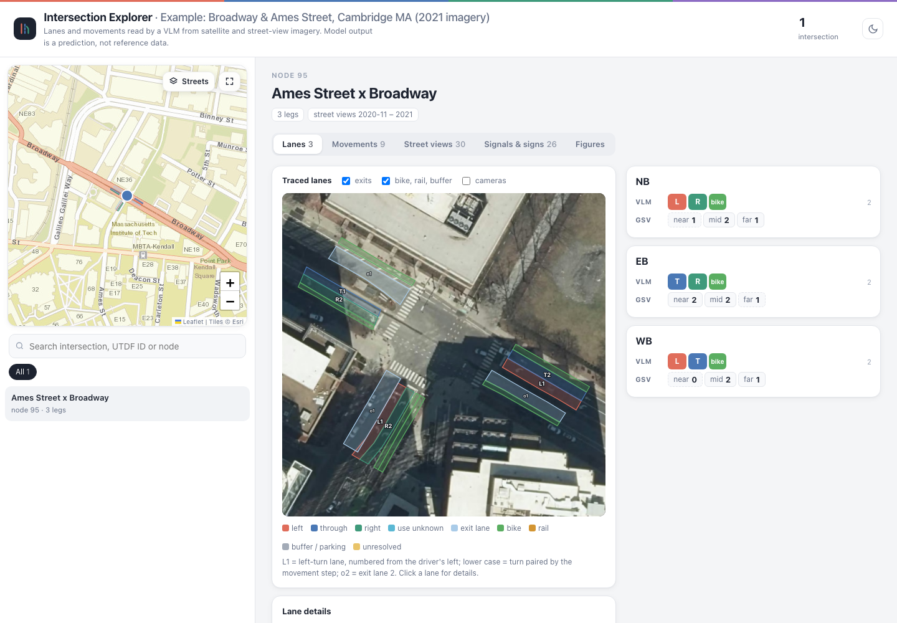
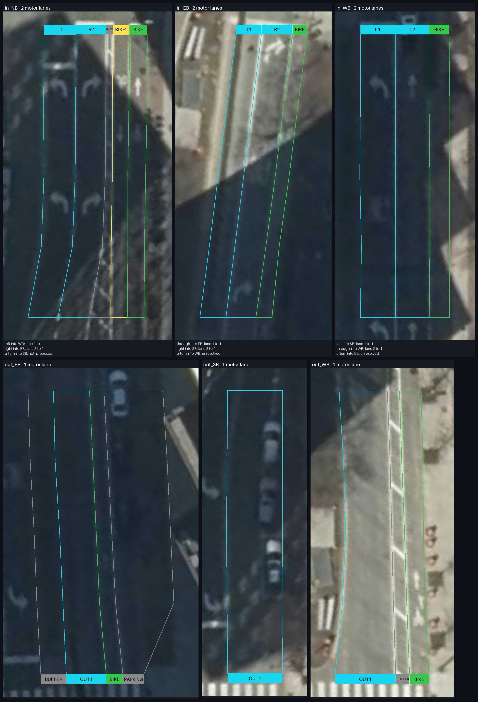

# Example: Broadway & Ames Street, Cambridge, Massachusetts

This is the output of one complete pipeline run at a signalised T-junction in Kendall Square. Broadway runs east–west, with a tree-lined median near the junction and bicycle lanes in both directions. Ames Street joins from the south. The run used tracing `autoloop-geometry-6` and classification `hybrid-pilot-v8-street-view-counts`.

The junction has been rebuilt since about 2022–2023, so the run reads it from imagery taken before that work:

- **Satellite:** MassGIS 2021 orthoimagery, spring 2021, leaf-off, 15 cm.
- **Street views for the lanes:** Google's own panoramas from November 2020, at all 15 positions (near, mid and far on each approach and exit). Each panorama stands on the carriageway of its section.
- **Street views for the signal and sign audit:** October 2019 to November 2020.
- **Network:** OpenStreetMap as of 1 May 2021, converted to GMNS. In that network the junction is node 95.

The Street View metadata service returns only the latest panorama at a location. Here the November 2020 panoramas are hidden behind captures from 2024 and 2026, so they were looked up in Google Maps' time travel and named in the policies:

- `pinned_panoramas` in `configs/acquisition/cambridge_pre_construction.json` assigns one panorama to each lane-view position.
- `known_panoramas` in `configs/control_policies/cambridge_pre_construction.json` lists candidate panoramas for the signal and sign audit.

The pipeline checks each named panorama's date, position and carriageway like any other.

There is no reference lane data for this junction. The dashboard shows the model's reading and the street-view lane counts only.

The model answers in this example come from a vision-language model other than the default (`gpt6_astra`). The answer files do not name it.



Model output is a prediction, not reference data.

## Dashboard

[`dashboard/intersection_explorer_example.html`](../../dashboard/intersection_explorer_example.html) is the dashboard built for this intersection alone. It is a single 1.8 MB file holding the data, the images and the map library. Download it and open it in a browser; only the background map tiles need a connection. It shows four things:

- The traced lanes on the satellite image.
- Each approach's lanes and movements, with the street-view lane counts.
- Every street view, with the model's observation boxes.
- The signal and sign audit, and the labelled figures.



## Lane panels



## What the model read

Motor lanes on each approach, and the motor lanes counted in the street views at three distances:

| Approach | Lanes read | Near | Mid | Far |
|---|---|---:|---:|---:|
| EB (Broadway from the west) | through, right only | 2 | 2 | 1 |
| WB (Broadway from the east) | left only, through | 0 | 2 | 1 |
| NB (Ames Street) | left only, right only | 1 | 2 | 1 |

Each approach also has a bicycle lane on its kerb side. Each exit has one motor lane. Leaving eastbound, the exit audit reads, from the median outwards: the median, the travel lane, a bicycle lane and kerbside parking.

The model proposed six movements:

- EB through and right.
- WB left and through.
- NB left and right.

It proposed no U-turn on Ames Street. On Broadway it left U-turns unresolved: no marking or sign in the imagery settles them.

The signal and sign audit made 26 readings on the three approaches. On Broadway westbound, the model read:

- a red left-arrow head and the sign LEFT TURN SIGNAL, both proposed for the left-turn lane;
- two green through-arrow heads;
- a keep-right sign on the median.

## Files

```
network/                     GMNS excerpt (nodes and links within 600 m of node 95), OpenStreetMap as of 2021-05-01
screenshots/                 dashboard screenshot used in the READMEs
figures/                     README figures: street views, projected boundaries, YOLO boxes, signals and signs, shade lift
results/
  imagery/                   site config, evidence config, exit views, acquisition record (capture dates, pinned panoramas)
  geometry/                  traced sections (lane boundaries on the satellite image) and the loop summary
  classification/            lanes, movements, lane-use audits, street-view contexts, CSV tables, report
  exits/                     exit re-audit
  controls/                  signal and sign audit
  atlas/                     GeoJSON of the lanes and rejected regions, atlas data, georeference, report
  images/                    satellite image and every street view, named by approach, position and direction
  annotated/                 lane labels, candidate and accepted regions, tracing plan, movements per approach
  answers/                   every raw model answer (56), laid out by stage
  export.json                list of the exported files
```

Paths inside the configs (for example `runs/imagery_cambridge2021b_95/...`) point into the run folders the results were exported from. Those folders are not included. The reports are in Chinese.

## Run it

The network excerpt is enough to list the sections and the request budget for this node, without any API key or network access:

```bash
python scripts/pipeline/run_site_pipeline.py --name example_95 --node-id 95 \
  --node-csv examples/broadway_ames_2021/network/node.csv \
  --link-csv examples/broadway_ames_2021/network/link.csv --plan-only
```

The full run used the dated acquisition policy and the matching signal-audit policy:

```bash
python scripts/pipeline/run_site_pipeline.py --name cambridge2021b_95 --node-id 95 \
  --node-csv examples/broadway_ames_2021/network/node.csv \
  --link-csv examples/broadway_ames_2021/network/link.csv \
  --acquisition-policy configs/acquisition/cambridge_pre_construction.json \
  --control-policy configs/control_policies/cambridge_pre_construction.json \
  --acquire --audit-controls
```

## Sources and attribution

- Satellite imagery: MassGIS (Bureau of Geographic Information), Commonwealth of Massachusetts, 2021 orthoimagery.
- Street-level imagery: © Google.
- Network: derived from OpenStreetMap, © OpenStreetMap contributors, ODbL.

The images are included here only to illustrate the method.
